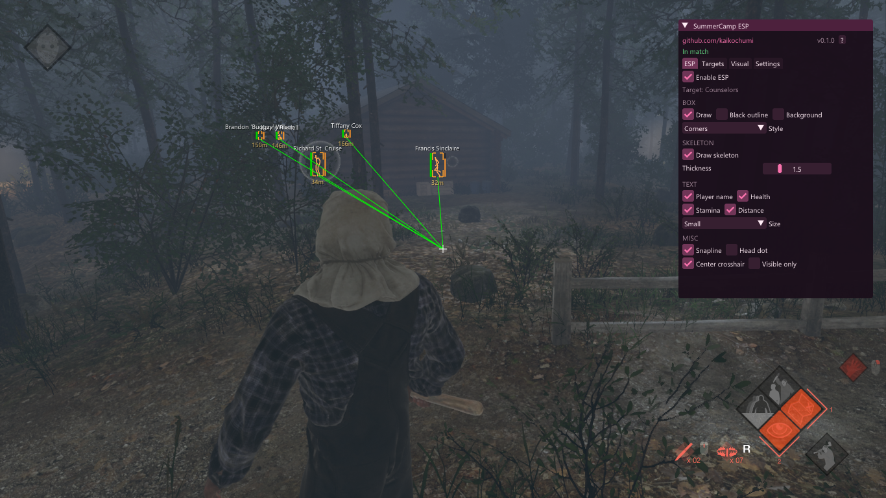
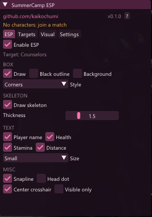
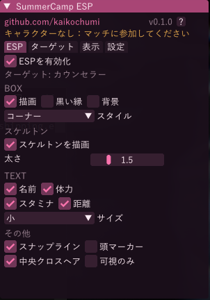

# SummerCamp ESP


Overlay ESP externo para o build original **Friday the 13th: The Game** *Summer Camp* (Camp Forest Green, Unreal Engine 4.18.3). Desenha caixas de jogadores, esqueletos e barras de vida em uma janela semitransparente sobreposta. O processo do jogo é aberto apenas para leitura: nada é escrito, sem injeção, sem driver de kernel.

O menu suporta inglês, japonês e português (aba `Configurações`, ou chave `lang` no arquivo de configuração).


*Jogando como Jason: quatro conselheiros rastreados com caixas de canto, esqueletos, snaplines e distâncias — menu aberto à direita.*

> [!IMPORTANT]
> **Funcionou? Deixe uma ⭐.** Este é um projeto de hobby — a estrela é o único sinal de que pessoas estão usando a ferramenta, e é o que motiva a próxima atualização de offsets quando o jogo muda.

## Screenshots

| Inglês | Português | Japonês |
|--------|-----------|---------|
|  |  |  |

*(Screenshot do menu em português usa a mesma imagem do japonês como placeholder — o menu real em PT-BR aparece ao selecionar "Português" nas configurações.)*

## Funcionalidades

- Player ESP: caixas (sólida / cantos / arredondada), esqueleto, nome, distância, barras de vida e stamina
- Snapline, marcador na cabeça, mira central (cada um ligável/desligável individualmente)
- Detecção automática de alvos: como conselheiro você rastreia o Jason; como Jason rastreia os conselheiros
- Aba "Alvos" com tabela ao vivo (nome, distância, vida, visibilidade)
- Todas as configurações são salvas no arquivo de config e sobrevivem a reinícios
- Click-through no overlay: apenas o menu aceita o mouse, o jogo recebe o resto da entrada

## Requisitos

Windows 10 ou superior, CMake 3.20+. Um dos compiladores:

- MinGW-w64 (testado com GCC 16)
- MSVC (Build Tools 2022 funciona sem mudanças)

Dear ImGui vem em `third_party/imgui`, então o build não precisa de acesso à rede. Apenas backends win32 e dx11 são incluídos.

## Build

Com MinGW:

```
cmake -B build -G "MinGW Makefiles"
cmake --build build -j
```

Com MSVC, omita a linha `-G` e compile a solution gerada. O executável sai em `build/summercamp-esp.exe`.

## Uso

Baixe `SummerCamp-ESP-v0.2.0-Win64.zip` do [último release](https://github.com/kaikochumi/SummerCamp-ESP/releases/latest), descompacte em qualquer pasta, inicie o jogo **primeiro**, depois a ferramenta:

```
summercamp-esp.exe --module summercamp --cfg esp.cfg
```

Ambas flags são opcionais. `--module` é o nome do módulo usado para achar o processo do jogo; `--cfg` aponta pro arquivo de config, que é criado com valores padrão na primeira execução e salvo sempre que você mexe no menu.

| Tecla   | Ação            |
|---------|-----------------|
| INSERT  | abre/fecha menu |
| END     | liga/desliga ESP |
| DELETE  | sai             |

Um preset ajustado pro visual padrão (caixas de canto finas laranja, esqueleto, distância em metros) vem em `config/preset.cfg`:

```
summercamp-esp.exe --cfg config/preset.cfg
```

## Configuração

O arquivo de config é um `key=value` por linha, com os mesmos nomes dos itens do menu. Cores usam a ordem IM_COL32 (`0xAABBGGRR`). `lang=0` inicia o menu em inglês, `lang=1` em japonês, `lang=2` em português; a fonte japonesa é carregada das fontes do sistema (Meiryo, depois Yu Gothic, depois MS Gothic).

## Offsets

O layout de memória fica em `src/offsets.h` e é documentado em [docs/OFFSETS.md](docs/OFFSETS.md). Valores foram mapeados das estruturas do engine e do jogo e confirmados rodando o jogo (UE 4.18.3, build 38951); outras versões do jogo terão endereços diferentes.

**Versão do jogo:** testado contra o build comunitário *Summer Camp* `4.18.3-38951` (launcher Camp Forest Green) em **outubro de 2026**. Se o seu binário do jogo for de outro build, os endereços precisam ser reconfirmados primeiro.

## Roadmap

- Objectives ESP: bateria do carro, gasolina, fusível, remédios, canivete
- Cores de caixa por papel (conselheiros vs Jason)
- Aviso de versão no menu quando o jogo atualizar
- Mais traduções pro menu

## Disclaimer

Este projeto lê memória do jogo de fora do processo e existe para estudo de layouts da Unreal Engine. Use por sua conta e risco; o autor não se responsabiliza por penalidades na conta ou outras consequências.

## Suporte

Se o ESP funcionou pra você, uma estrela é o melhor feedback — é o que mantém este repo ativo e faz [docs/OFFSETS.md](docs/OFFSETS.md) ser atualizado mais rápido quando o jogo muda.

⭐ [**Dar estrela em kaikochumi/SummerCamp-ESP**](https://github.com/kaikochumi/SummerCamp-ESP/stargazers)